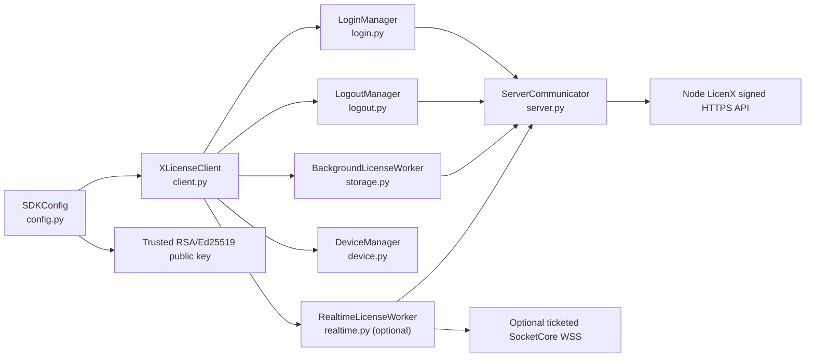

# SDK-DFSE forensic documentation audit — LicenX Python SDK 1.2.6

> **Audit snapshot:** 2026-11-18, the authorized Windows project workspace. **Task scope:** SDK documentation and existing source-map notes only. **Final documentation-readiness assessment:** **UNVERIFIED** for distribution/production (see validation limits below), despite source-level reconciliation and structural validation. No Git operation, SDK source/test/package config change, live license activation or production operation was authorized.

## A. SDK overview and architecture

**Product:** LicenX Python SDK `licenx`, source package `SDK/client/python/licenx/`. **Only maintained language SDK found:** one Python distribution with a flat package layout using `[tool.setuptools].package-dir = { licenx = "." }`, not a nested `licenx/licenx/` directory. Version `1.2.6` matches `pyproject.toml` and `__init__.py`. `requires-python >=3.8`; cryptography is required, `requests` and `websocket-client` are optional transport extras. Python compatibility is **declared**, not revalidated on every interpreter during this task.

**Runtime path:** load a trusted literal config (or explicit `SDKConfig`) → `XLicenseClient.login()` → local HWID + minimal device telemetry → signed online `/api/v1/license/validate` → fail-closed key/signature/challenge/device/app verification → in-memory licensed session with optional heartbeat/WSS → explicit `logout()` using signed-session v2 proof or unconfirmed release handling. No initial offline authorization or persisted plaintext/reversible license key. WSS state alone is not permission; nonce-bound signed HTTPS proof remains authoritative.

**Source modules inspected (12):** `__init__.py`, `client.py`, `config.py`, `device.py`, `diagnostics.py`, `example_app.py`, `login.py`, `logout.py`, `offline.py`, `realtime.py`, `server.py`, `storage.py`. Also inspected the `licenx.config.py` template, `pyproject.toml`, `requirements.txt`, `scripts/buildPythonSdkArchive.mjs`, `.github/workflows/release-python-sdk.yml`, and affected backend UI/server policy paths.

**Tests:** 18 `test_*.py` modules and **193 named test method declarations** enumerated by source scan; selected implementations were inspected for config parsing, session-storage deletion, v2 logout and signed legacy keep-login policy. These tests were **not rerun** because Python was unavailable on the authorized Windows device. Test declaration count is not a test-pass count.

## B. Documentation ownership and distribution

| Owner/location | Intended audience | Language/content | Actual shipping boundary |
| --- | --- | --- | --- |
| `SDK/client/python/licenx/README.md` | SDK consumers | English install/quick start, module overview | Source kit ZIP; PyPI project README metadata via `pyproject.toml`; **not one of the three wheel package-data documents** |
| `SDK/client/python/licenx/docs/{README,GUIDE_EN,GUIDE_BN}.md` | Consumers of installed package | Index, English and Bangla integration | Declared in `pyproject.toml [tool.setuptools.package-data]`; present in inspected local source ZIP; **wheel itself not built/inspected** |
| `SDK/client/python/docs/{README,CONFIGURATION,API_REFERENCE,GUIDE_EN,GUIDE_BN}.md` | Integration developers maintaining source checkout | English API, mixed Bangla/English config, language entry points | **Repository-only**, omitted from generated ZIP and wheel package-data |
| `SDK/client/python/licenx/docs/SDK feature/` (36 existing notes) | Source auditors/maintainers | Module/test maps and historical snapshots, largely English with a Bangla source note | **Repository-only**; source ZIP excludes it, wheel package-data does not declare it |
| `SDK/client/python/licenx/test/README.md` and `SDK/VERIFICATION_AUDIT.md` | Test operators/auditors | Test-console and dated historical verification | Repository-only; not current production proof |
| `SDK/PRIMARY_SDK_MIGRATION.md`, dated release notes and release-request text | Release maintainers | Migration history and released-version claims | Repository-only; do not treat historical CI/PyPI statements as checks performed in this audit |

**Artifact check:** Existing `public/licenx-python-sdk.zip` opened read-only and contained **20 entries**. `__init__.py`, `config.py` and `pyproject.toml` entries matched current source text. The current **modified** `README.md`, `docs/README.md`, `docs/GUIDE_EN.md` and `docs/GUIDE_BN.md` no longer match that prebuilt ZIP (expected after documentation edits); the ZIP intentionally excludes `test/` and `docs/SDK feature/`. No local wheel/sdist build directory was present and no Python runtime was detected. **A separately authorized archive rebuild and wheel/sdist inspection are required before claiming release artifacts include the synchronized docs.**

## C. Public API traceability matrix

Status here means source-to-document contract comparison, **not** runtime validation. Detailed signatures, return types, aliases and errors: [Public API reference](API_REFERENCE.md).

| SDK component / public surface | Implementation path | Active documentation | Status after correction | Notes |
| --- | --- | --- | --- | --- |
| `XLicenseClient` facade, lifecycle, callbacks | `licenx/client.py:17-322` | [API](API_REFERENCE.md), package README, language guides | **VERIFIED (static)** | 14 ctor options; `login(pin)` ignored; logout confirmation and WSS UI hints clarified |
| `SDKConfig` fields, constructor, discovery/export | `licenx/config.py:13-412` | [Config](CONFIGURATION.md), [API](API_REFERENCE.md) | **VERIFIED (static)** | 15 fields/defaults, strict Python literal AST, JSON compatibility |
| `DeviceManager` HWID and telemetry | `licenx/device.py:19-215` | [API](API_REFERENCE.md), source-map device.md | **VERIFIED (static)** | Full/public-IP lookup opt-in; LAN fallback caveat |
| `ServerCommunicator` / `ServerClient` alias | `licenx/server.py:44-616` | [API](API_REFERENCE.md), source-map server.md | **VERIFIED (static)** | v2 signed-proof logout, RSA/Ed25519, urllib/requests |
| `BackgroundLicenseWorker` / `LicenseStorage` alias | `licenx/storage.py:31-429` | [API](API_REFERENCE.md), source-map storage.md | **VERIFIED (static)** | No persisted session; bounded heartbeat; WSS UI hint not authorization |
| `OfflineGuard` / `OfflineLicenseManager` alias | `licenx/offline.py:11-44` | [API](API_REFERENCE.md), source-map offline.md | **VERIFIED (static)** | Helpers only; no offline login |
| `LoginManager`, `LoginResult` | `licenx/login.py:18-128` | [API](API_REFERENCE.md), source-map login.md | **VERIFIED (static)** | Dataclass all fields; no invalid-signature logout |
| `LogoutManager` | `licenx/logout.py:17-144` | [API](API_REFERENCE.md), source-map logout.md | **VERIFIED (static)** | Pending release stays RAM-only; signal/atexit best effort |
| `RealtimeLicenseWorker` (**not root-exported**) | `licenx/realtime.py:29-429` | [Config](CONFIGURATION.md), packaged EN/BN guides | **VERIFIED (static)** | Optional, signed ticket/snapshot, HTTPS recovery, metadata-policy caveat |
| `SafeDiagnosticBuffer` (**not root-exported**) | `licenx/diagnostics.py:28-57` | [API](API_REFERENCE.md), source-map index | **INCOMPLETE** | Internals described, no independent public API promise |
| `SDKConfigError` (**not root-exported**) | `licenx/config.py:13-18` | [API](API_REFERENCE.md), [Config](CONFIGURATION.md) | **VERIFIED (static)** | Import from `licenx.config`; allowlisted error codes |
| Package install/ZIP/wheel/sdist | `pyproject.toml`, `buildPythonSdkArchive.mjs` | [README](../licenx/README.md), this report | **PARTIALLY VERIFIED** | ZIP inspected; actual wheel/sdist install/build not run |

**Coverage rule:** all 12 `licenx.__all__` exports are now represented. Direct import of internal modules does not imply a stable SDK facade promise. This matrix does not assert full 193-test execution or exhaustive branch review.

## D. Findings and reconciliation

| ID | Severity | Documentation / source | Verified mismatch or gap | Disposition |
| --- | --- | --- | --- | --- |
| DFSE-01 | **HIGH** | Source-map `client.md`; `client.py` | Invalid `finally` outside `try` and undefined demonstration variables | **Fixed** with valid config-dependent lifecycle sample |
| DFSE-02 | **HIGH** | Source-map `server.md`; `server.py:569+` | Claimed insecure legacy v1 logout/deactivate fallback; v1 SDK fallback absent | **Fixed**: v2 one-use proof and verified renewal documented |
| DFSE-03 | **HIGH** | `CONFIGURATION.md`; `storage.py:315+`; `test_realtime.py:499+` | Claimed `keep_login_on_network_error=False` auto-invalidates opted-in UI hint; source/tests retain hint for ON and OFF, while denying protected work | **Fixed**: explicit current behavior and separate HTTP-only policy |
| DFSE-04 | **HIGH** | Packaged `docs/README.md`, EN/BN guides; `pyproject.toml` | Packaged Markdown linked to technical/source-map files excluded from wheel data | **Fixed**: packed-only nav links and explicit repository-only references |
| DFSE-05 | **MEDIUM** | Source-map `package-init.md`; `__init__.py` / manifest | Current version incorrectly presented as 1.2.3 | **Fixed**: 1.2.6 and correct manifest/tag ownership |
| DFSE-06 | **MEDIUM** | Source-map `login.md`; `login.py` | Claimed failed signature/clock veto causes remote cleanup; current login does neither | **Fixed** with actual negative-path behavior |
| DFSE-07 | **MEDIUM** | `API_REFERENCE.md`; `__init__.py` | API reference omitted many root exports, exact facade methods/returns and constructors | **Fixed**: 12-export matrix, signatures, `LoginResult`, errors, aliases |
| DFSE-08 | **MEDIUM** | `CONFIGURATION.md`; `config.py` | Default/loader/unknown-field precedence not fully described | **Fixed**: 15-field/default table, literal config and error codes |
| DFSE-09 | **MEDIUM** | Packaged English/Bangla guides; `client.py`, `realtime.py` | Missing realtime authorization/UI distinction and v2 logout failure handling | **Fixed**: aligned EN/BN sections |
| DFSE-10 | **MEDIUM** | Package README; `test_readme_quick_start.py` | Quick example did not show explicit cleanup and prints HWID | **Improved**: additional valid `finally` sample; retained tested basic snippet and marked HWID display demo-only |
| DFSE-11 | **MEDIUM** | `docs/SDK feature/README.md` | Feature index omitted `realtime.py` and `diagnostics.py` | **Fixed**: module ownership added, repository-only context clarified |
| DFSE-12 | **LOW** | Source-map `docs-portal.md`; packaged index | Claimed portal contains example/module table it did not contain | **Fixed** |
| DFSE-13 | **LOW** | `release-notes-v1.2.3.md` source-map note | Labeled old 1.2.3 “current” and claimed active key printed in current example | **Fixed**, historical record still preserved |
| DFSE-14 | **HIGH** | Prebuilt `public/licenx-python-sdk.zip` (non-doc artifact) | Current corrected README and packaged guides differ from ZIP bytes | **OPEN — outside documentation write scope**; authorized new archive/release build needed |
| DFSE-15 | **MEDIUM** | Wheel/sdist and runtime test environment | No Python interpreter or wheel/sdist build artifacts available to execute install and examples | **NOT VERIFIED**; requires controlled Python test/package gate |
| DFSE-16 | **LOW** | `device.py:127-145` | Public-IP lookup failure returns local IP under `public_ip` label | **Source-level limitation documented; no code change** |
| DFSE-17 | **INFORMATIONAL** | Historical source-map/test/release notes | Historical test counts/version narratives are not current evidence | Preserved with ownership caveats; not individually re-certified |
| DFSE-18 | **LOW** | Project-wide `docs/users/features/python-sdk.md` | Used a nested `licenx/__init__.py` path that does not exist in this flat-layout project; implied remote logout always releases the device | **Fixed** implementation path and confirmation semantics |

## E. Documentation changes and file-level scope

Only **SDK-related Markdown documentation** was written (including the existing project-wide Python SDK user guide); source, tests, packaging configuration, local ZIP and release workflow remain untouched.

| Path (relative to `SDK/client/python/`) | Why changed |
| --- | --- |
| `docs/API_REFERENCE.md` | Expanded public export/API/return/alias/error contract |
| `docs/CONFIGURATION.md` | Corrected realtime legacy policy claims; added full config matrix and loader precedence |
| `docs/README.md` | Clarified repository-only ownership and linked this audit |
| `docs/SDK_DFSE_AUDIT_2026-11-18.md` | **New:** evidence, full traceability, finding disposition, distribution and readiness report |
| `licenx/README.md` | Clarified safe logout, UI hints, lifecycle sample, and repository-only links |
| `licenx/docs/README.md` | Removed wheel-incompatible source-map/package README links; clarified shipped docs |
| `licenx/docs/GUIDE_EN.md` | Added current realtime/error/cleanup guidance and package-safe navigation |
| `licenx/docs/GUIDE_BN.md` | Equivalent Bangla correction and package-safe navigation |
| `licenx/docs/SDK feature/README.md` | Completed realtime/diagnostics source index |
| `licenx/docs/SDK feature/client.md` | Repaired invalid Python `try/finally` example |
| `licenx/docs/SDK feature/login.md` | Removed disproven negative-path unbind claims |
| `licenx/docs/SDK feature/server.md` | Documented proof-based v2 logout, no anonymous fallback |
| `licenx/docs/SDK feature/package-init.md` | Corrected package version and root export scope |
| `licenx/docs/SDK feature/docs-portal.md` | Corrected packaged index's actual contents |
| `licenx/docs/SDK feature/release-notes-v1.2.3.md` | Reclassified historical note and corrected present-day source claims |
| `../../../docs/users/features/python-sdk.md` (project-root docs) | Corrected flat-package `__init__.py` path and clarified remote logout confirmation |

**File inventory:** See the appended 50-document ownership table below; **no source documentation directory was renamed, merged or deleted**.

## F. Verification status and limits

**Verified by reading exact current source:** 12 core package modules, flat package mapping, 12 root exports, selected constructor/return/error/loader semantics, v2 logout, stored-key deletion, WSS trust boundary and keep-login test semantics, parser/metadata paths, source ZIP 20-entry file inventory.

**Partially verified:** wheel package-data is declared and old `SOURCES.txt` lists bundled guides; **no newly built wheel/sdist artifact** was available for independent inspection. Existing SDK source ZIP was inspected and is now intentionally out of sync with updated documentation.

**Not verified:** current Python runtime tests, fresh wheel installation, example execution, installer, signed production license activation/heartbeat/remote logout, live WSS/proxy, PyPI state/version on the Internet, binary/source distribution reproducibility after this docs task. Tests and examples were read statically, not executed. Historical CI claims were not rerun.

**Not applicable:** rebuilding SDK source, modifying tests, changing package version, creating a release/tag, updating Git, or deploying to VPS. These require separate authorization.

## G. Production-readiness assessment: **UNVERIFIED**

Source-to-document signature and policy consistency was corrected, but an actual production-readiness or distribution-synchronization PASS would be misleading without a Python test environment, wheel/sdist installation, and a newly authorized source-kit build/verification. The source-kit **documentation drift** is an explicitly open release prerequisite; the current source code was not changed.

For future authorized acceptance, run the SDK unit suite in a disposable Python 3.8+ environment, build `python -m build --wheel --sdist SDK/client/python/licenx` in an isolated packaging job, inspect installed package data in a clean venv, regenerate/verify the source kit and its document hashes, verify public API examples, and separately validate allowed staging SDK login/logout and WSS. None of those commands were executed during this audit.

### Memory synchronization handoff

Root `MEMORY.md` is outside this documentation-only SDK scope. If an agent needs a shared memory update, append **this exact Markdown** in an authorized session:

> **2026-11-18 SDK-DFSE:** Current `licenx` SDK is flat-layout Python 1.2.6; 12 root exports documented. SDK package/repository docs corrected for config defaults, v2-only proof logout, no persisted license keys, opted-in WSS UI-only continuity independent of signed legacy keep-login ON/OFF, and wheel-vs-source docs ownership. Full report: `SDK/client/python/docs/SDK_DFSE_AUDIT_2026-11-18.md`. Existing 20-entry `public/licenx-python-sdk.zip` still contains old README/guide versions; no SDK code, tests, packaging, Git or VPS changes made. Runtime tests/wheel/sdist build not run; release synchronization pending separate approval.

## Appendix — existing documentation inventory and ownership

The **50 pre-existing SDK Markdown documents** below were all machine-read for this inventory; the source-focused verification was deeper for active guides than for archival per-file notes. Status **CORRECTED (STATIC)** means source-checked targeted edits, not runtime verification. Historical notes were preserved and should not be read as a current release test report.

| File (repository-relative) | Audience / language | Distribution ownership | Audit disposition |
| --- | --- | --- | --- |
| `SDK/client/python/docs/API_REFERENCE.md` | Integrator / English | Integrator; repository-only | CORRECTED (STATIC) |
| `SDK/client/python/docs/CONFIGURATION.md` | Integrator / Mixed Bangla/English | Integrator; repository-only | CORRECTED (STATIC) |
| `SDK/client/python/docs/GUIDE_BN.md` | Integrator / Bangla | Integrator; repository-only | INDEXED; reviewed against applicable source |
| `SDK/client/python/docs/GUIDE_EN.md` | Integrator / English | Integrator; repository-only | INDEXED; reviewed against applicable source |
| `SDK/client/python/docs/README.md` | Integrator / English | Integrator; repository-only | CORRECTED (STATIC) |
| `SDK/client/python/licenx/docs/GUIDE_BN.md` | Integrator / Bangla | Consumer; wheel package-data declared; source ZIP | CORRECTED (STATIC) |
| `SDK/client/python/licenx/docs/GUIDE_EN.md` | Integrator / English | Consumer; wheel package-data declared; source ZIP | CORRECTED (STATIC) |
| `SDK/client/python/licenx/docs/README.md` | Integrator / English | Consumer; wheel package-data declared; source ZIP | CORRECTED (STATIC) |
| `SDK/client/python/licenx/docs/SDK feature/AUDIT_SUMMARY.md` | QA / English | Source/auditor; repository-only | INDEXED; historic claims not fully revalidated |
| `SDK/client/python/licenx/docs/SDK feature/client.md` | Maintainer / English | Source/auditor; repository-only | CORRECTED (STATIC) |
| `SDK/client/python/licenx/docs/SDK feature/config.md` | Maintainer / English | Source/auditor; repository-only | INDEXED; historic claims not fully revalidated |
| `SDK/client/python/licenx/docs/SDK feature/device.md` | Maintainer / English | Source/auditor; repository-only | INDEXED; historic claims not fully revalidated |
| `SDK/client/python/licenx/docs/SDK feature/diagnostic-console.md` | Maintainer / English | Source/auditor; repository-only | INDEXED; historic claims not fully revalidated |
| `SDK/client/python/licenx/docs/SDK feature/diagnostic-launcher.md` | Maintainer / English | Source/auditor; repository-only | INDEXED; historic claims not fully revalidated |
| `SDK/client/python/licenx/docs/SDK feature/docs-portal.md` | Maintainer / English | Source/auditor; repository-only | CORRECTED (STATIC) |
| `SDK/client/python/licenx/docs/SDK feature/example-app.md` | Maintainer / English | Source/auditor; repository-only | INDEXED; historic claims not fully revalidated |
| `SDK/client/python/licenx/docs/SDK feature/guide-bn.md` | Maintainer / Bangla | Source/auditor; repository-only | INDEXED; historic claims not fully revalidated |
| `SDK/client/python/licenx/docs/SDK feature/guide-en.md` | Maintainer / English | Source/auditor; repository-only | INDEXED; historic claims not fully revalidated |
| `SDK/client/python/licenx/docs/SDK feature/legacy-audit.md` | QA / English | Source/auditor; repository-only | INDEXED; historic claims not fully revalidated |
| `SDK/client/python/licenx/docs/SDK feature/login.md` | Maintainer / English | Source/auditor; repository-only | CORRECTED (STATIC) |
| `SDK/client/python/licenx/docs/SDK feature/logout.md` | Maintainer / English | Source/auditor; repository-only | INDEXED; historic claims not fully revalidated |
| `SDK/client/python/licenx/docs/SDK feature/offline.md` | Maintainer / English | Source/auditor; repository-only | INDEXED; historic claims not fully revalidated |
| `SDK/client/python/licenx/docs/SDK feature/package-init.md` | Maintainer / English | Source/auditor; repository-only | CORRECTED (STATIC) |
| `SDK/client/python/licenx/docs/SDK feature/package-readme.md` | Maintainer / English | Source/auditor; repository-only | INDEXED; historic claims not fully revalidated |
| `SDK/client/python/licenx/docs/SDK feature/README.md` | Maintainer / English | Source/auditor; repository-only | CORRECTED (STATIC) |
| `SDK/client/python/licenx/docs/SDK feature/release-notes-v1.2.2.md` | Release / English | Source/auditor; repository-only | INDEXED; historic claims not fully revalidated |
| `SDK/client/python/licenx/docs/SDK feature/release-notes-v1.2.3.md` | Release / English | Source/auditor; repository-only | CORRECTED (STATIC) |
| `SDK/client/python/licenx/docs/SDK feature/requirements.md` | Maintainer / English | Source/auditor; repository-only | INDEXED; historic claims not fully revalidated |
| `SDK/client/python/licenx/docs/SDK feature/server.md` | Maintainer / English | Source/auditor; repository-only | CORRECTED (STATIC) |
| `SDK/client/python/licenx/docs/SDK feature/storage.md` | Maintainer / English | Source/auditor; repository-only | INDEXED; historic claims not fully revalidated |
| `SDK/client/python/licenx/docs/SDK feature/test-client-session-replacement.md` | QA / English | Source/auditor; repository-only | INDEXED; historic claims not fully revalidated |
| `SDK/client/python/licenx/docs/SDK feature/test-example-app-security.md` | QA / English | Source/auditor; repository-only | INDEXED; historic claims not fully revalidated |
| `SDK/client/python/licenx/docs/SDK feature/test-heartbeat.md` | QA / English | Source/auditor; repository-only | INDEXED; historic claims not fully revalidated |
| `SDK/client/python/licenx/docs/SDK feature/test-heartbeat-interval.md` | QA / English | Source/auditor; repository-only | INDEXED; historic claims not fully revalidated |
| `SDK/client/python/licenx/docs/SDK feature/test-live-config.md` | QA / English | Source/auditor; repository-only | INDEXED; historic claims not fully revalidated |
| `SDK/client/python/licenx/docs/SDK feature/test-login-cleanup.md` | QA / English | Source/auditor; repository-only | INDEXED; historic claims not fully revalidated |
| `SDK/client/python/licenx/docs/SDK feature/test-logout-lifecycle.md` | QA / English | Source/auditor; repository-only | INDEXED; historic claims not fully revalidated |
| `SDK/client/python/licenx/docs/SDK feature/test-pin-is-ignored.md` | QA / English | Source/auditor; repository-only | INDEXED; historic claims not fully revalidated |
| `SDK/client/python/licenx/docs/SDK feature/test-readme.md` | QA / English | Source/auditor; repository-only | INDEXED; historic claims not fully revalidated |
| `SDK/client/python/licenx/docs/SDK feature/test-readme-quick-start.md` | QA / English | Source/auditor; repository-only | INDEXED; historic claims not fully revalidated |
| `SDK/client/python/licenx/docs/SDK feature/test-secure-transport.md` | QA / English | Source/auditor; repository-only | INDEXED; historic claims not fully revalidated |
| `SDK/client/python/licenx/docs/SDK feature/test-signature-verification.md` | QA / English | Source/auditor; repository-only | INDEXED; historic claims not fully revalidated |
| `SDK/client/python/licenx/docs/SDK feature/test-storage-security.md` | QA / English | Source/auditor; repository-only | INDEXED; historic claims not fully revalidated |
| `SDK/client/python/licenx/docs/SDK feature/test-transport-errors.md` | QA / English | Source/auditor; repository-only | INDEXED; historic claims not fully revalidated |
| `SDK/client/python/licenx/README.md` | Integrator / English | Consumer; source ZIP and wheel metadata README | CORRECTED (STATIC) |
| `SDK/client/python/licenx/test/README.md` | QA / English | QA; repository-only | INDEXED; reviewed against applicable source |
| `SDK/PRIMARY_SDK_MIGRATION.md` | Release / English | Release/audit history; repository-only | INDEXED; reviewed against applicable source |
| `SDK/RELEASE_NOTES_v1.2.2.md` | Release / English | Release/audit history; repository-only | INDEXED; historic claims not fully revalidated |
| `SDK/RELEASE_NOTES_v1.2.3.md` | Release / English | Release/audit history; repository-only | INDEXED; historic claims not fully revalidated |
| `SDK/VERIFICATION_AUDIT.md` | QA / English | Release/audit history; repository-only | INDEXED; historic claims not fully revalidated |
| docs/users/features/python-sdk.md | Integrator / English | Project-wide SDK guide; repository-only | CORRECTED (STATIC) |
| SDK/client/python/docs/SDK_DFSE_AUDIT_2026-11-18.md | Auditor / English | New repository-only source/traceability report | NEW |

**Inventory total:** 50 pre-existing SDK documents plus one related project-wide SDK guide reviewed, and this new SDK-DFSE report = **52 SDK-relevant Markdown files** in the post-audit documentation scope. **Writes:** 15 existing documentation files corrected, one new audit report. No other workspace files were intentionally written.

## H. Final focused post-edit QA receipt

**Source-root exports corrected against exact `__init__.py`: 12 names**, including three compatibility aliases; each name appears in [API_REFERENCE.md](API_REFERENCE.md). The earlier working draft's 11-name count was corrected before closing this audit.

| Documentation/traceability check | Actual result |
| --- | --- |
| Existing SDK Markdown files inventoried and content-read | **50** |
| New forensic audit report | **1** |
| Related project-level Python SDK guide audited | **1** |
| Final SDK-related Markdown scope | **52 files** |
| Core package Python source modules reviewed | **12 files** |
| Package-root `__all__` names compared to API reference | **12/12 found** |
| Test modules enumerated / named test declarations | **18 / 193** (static, not executed) |
| SDK-related relative Markdown links checked | **70**; **0 missing** (final post-receipt check) |
| Packaged EN/BN/index relative links checked | **6**; **0 unshipped-file dependencies** |
| Markdown files lacking H1 | **0** |
| Markdown fenced-code boundary markers | **62**, balanced |
| Prebuilt source ZIP entries inspected | **20**; current Python source core compared (3 matches), **4 edited docs differ** |
| Actual wheel/sdist rebuild/install, Python test execution | **NOT VERIFIED**; Python executable absent |
| Git status/commits/pushes, VPS deployment | **NOT PERFORMED** — out of scope |

**Static documentation consistency gate: PASS.** **Distribution/production readiness remains UNVERIFIED** until a separately authorized source-kit regeneration, wheel/sdist inspection/install and Python/CI verification. No production operations, SDK source, tests, dependency manifests, package configuration, release pipeline or existing archive bytes were modified.
