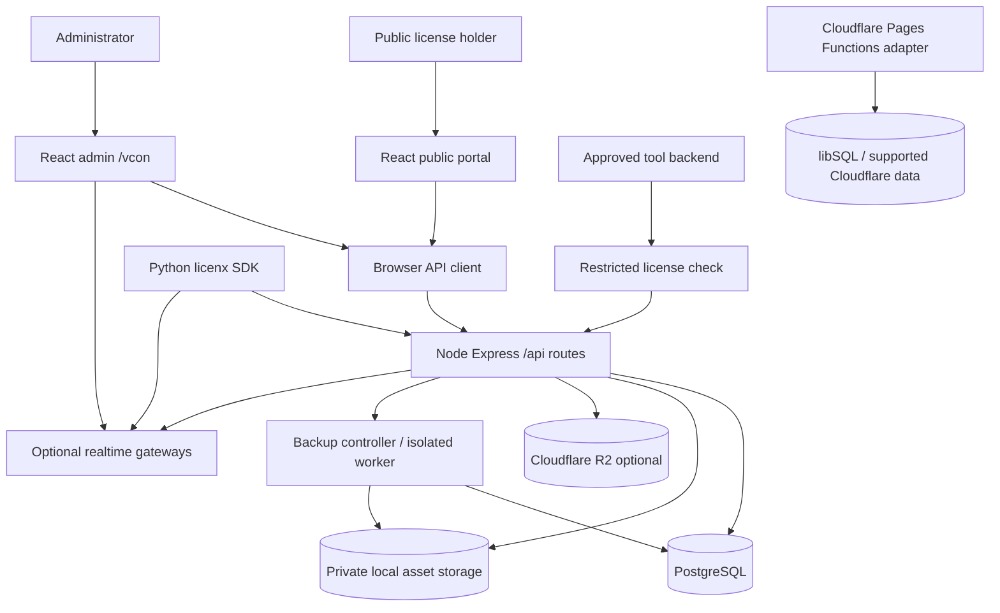
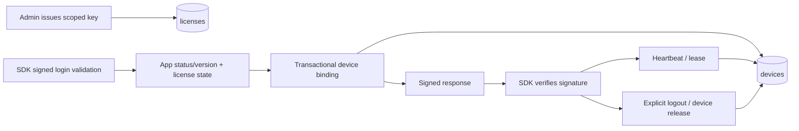

# LicenX system architecture

The application is a single TypeScript/React frontend backed by the Node Express API in the VPS deployment. A Cloudflare Pages adapter shares parts of the server implementation but differs in persistence and runtime capabilities. The Python client is separately packaged and validates signed license responses.

## Component topology

Production Caddy forwards HTTPS traffic to the Node application in standalone mode. `compose.yaml` defines `postgres`, `app` and an optional `caddy` profile. `src/server/database/postgres.ts` translates the database contracts to the `pg` driver; `src/server/db.ts` chooses the provider. `src/server/storage/` abstracts private/public files. See [Database](database-schema.md).

## Request path

1. `server.ts` loads environment, binds liveness/readiness and bounded sensitive parsers, sets route mounts, initializes DB schema and optionally starts realtime transports.
2. Browser `src/services/apiClient.ts` sends authenticated admin requests or public requests. Shared rules in `src/server/api.ts` perform validation, authenticate permissions, execute SQL/storage operations and shape responses.
3. `src/App.tsx` resolves public and admin URLs and mounts the matching page; admin source of navigation is `src/components/Sidebar.tsx`.
4. Python `SDK/client/python/licenx/client.py` composes config/login/device/heartbeat/logout modules, verifies server signatures and enforces trusted lease handling.

## Core license lifecycle

Real device activation/heartbeat runs through `/api/v1/license/validate`, `/api/v1/license/ping` and `/api/v1/license/logout` (with compatibility aliases). It is **stateful**, not merely a “test endpoint”. `src/server/deviceBinding.ts` uses license-level transaction locking on PostgreSQL. Optional websocket tickets/gateways do not replace this signed HTTPS path.

## Realtime and backup isolation

The license SocketCore transport and admin WebSocket gateway have **independent** environment flags, auth rules and subjects. Backup control spawns a bounded worker for encrypted snapshots or restore; server readiness is deliberately unavailable during restore.

**Evidence:** `server.ts:1-213`, `src/server/api.ts`, `src/server/db.ts`, `src/server/realtime/`, `src/server/fullBackupWorker.ts`, `engine/socketcore/`, `functions/`, `compose.yaml`. Diagram depicts implemented source paths, not a verified current production network topology.