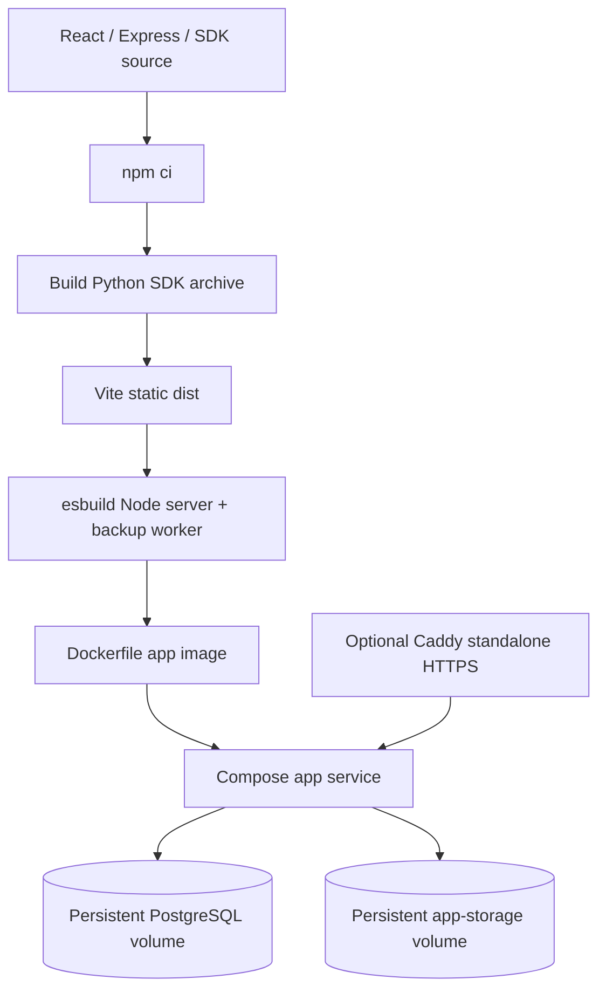

# Build, packaging, deployment and release

## Node/web artifact composition

`package.json` declares `prebuild` → `npm run build:sdk-archive`, `build` → `vite build && npm run build:server`, and `build:server` bundles `server.ts` and `src/server/fullBackupWorker.ts` with esbuild. The runtime command is `node build/server.js`. The SDK ZIP is generated from the maintained Python source kit by `scripts/buildPythonSdkArchive.mjs`.

## Docker and HTTPS

`compose.yaml`: Postgres 17.6 image, Node `app` with internal backend network and persistent local storage, optional Caddy 2.10.2 under `standalone-https`. Host secrets are injected from private environment variables; the app listens on port 3000 inside Compose, Caddy terminates HTTPS when selected. `deploy/compose.existing-proxy.yaml` supports a separately managed proxy environment.

`scripts/install-vps.sh` supports `--check`, `--mode standalone` and `--mode existing-proxy`. Do not invent a one-line installer that overwrites existing volumes/credentials; use the documented installer preflight.

## Continuous integration

Declared workflows in `.github/workflows/` include `phase03-docker.yml`, `phase04-installer.yml`, `phase05-security.yml`, `pn01-public-catalog.yml`, `admin-realtime-e2e.yml`, `backup-system.yml`, `sd01-server-diagnostics.yml`, `release-python-sdk.yml` and `start-python-sdk-release.yml`. A workflow file being present does not imply the latest commit has passed every job.

Python SDK release is a separately controlled version/tag operation; normal source pushes do not imply PyPI publication. Inspect `SDK/PRIMARY_SDK_MIGRATION.md` and the actual workflow triggers before any release.

## Production safety

Any production update requires independent approval, checked target SHA, backup/recovery readiness, rollback image, disk/health baseline, app-only recreate where applicable, and live smoke/browser acceptance. The last recorded HF-01 owner acceptance used app-only update; a later docs commit did **not** automatically update that production image.

**Source:** `package.json`, `Dockerfile`, `compose.yaml`, `deploy/Caddyfile`, `scripts/install-vps.sh`, `.github/workflows/`, `README.md`.